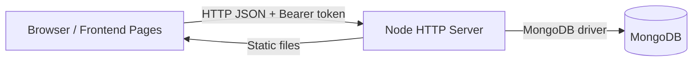

# Business Discovery — Master Documentation

*Authoritative reference for all future development.*

---

## Table of Contents

1. [Project Overview](#1-project-overview)
2. [Technology Stack](#2-technology-stack)
3. [Repository Structure](#3-repository-structure)
4. [Application Architecture](#4-application-architecture)
6. [Authentication & Authorization](#6-authentication--authorization)
[Registration Flow](#b-registration-flow)
[Homepage and Modern Visual Redesign](#c-homepage-and-modern-visual-redesign)
[Homepage Hero and Visual Content](#d-homepage-hero-and-visual-content)
[3D Visual Design](#e-3d-visual-design)
[Floating AI Assistant](#f-floating-ai-assistant)
[User, Business, and Administrator Settings](#g-user-business-and-administrator-settings)
[Real Website Statistics](#h-real-website-statistics--no-fake-data)
[Main Super Admin Security](#i-main-super-admin-security)
[Role-Aware Dashboard and Projectless Accounts](#17-role-aware-dashboard-and-projectless-accounts)
[System Information](#18-system-information)
14. [Conflicts & Unresolved Decisions](#14-conflicts--unresolved-decisions)
15. [Documentation Governance](#15-documentation-governance)
16. [Appendix: Source Documents](#16-appendix-source-documents)

---
## 1. Project Overview

Business Discovery is a web platform for managing business discovery projects, project members and participants, friends and partners, tasks, notifications, and chat conversations. It includes a site administration area for user statistics and application settings.

Current scope verified from source code:
- Multi-page frontend served by the Node backend.
- Custom HTTP server (not Express).
- MongoDB-backed persistence.
- Email/password authentication with signed tokens.
- Role-based authorization: regular_user, site_admin, main_super_admin.
- Backend database role is the source of truth for authorization.
- 20 application pages plus a custom 404 page, including role-aware dashboards, private CV/profile management, project assessment, an Ollama planning assistant, system information, product management, and a public shop.
- 18 MongoDB collections, including project assessments, products, and orders.
- Project-linked task completion requires project-manager approval.
- Product and order workflows are limited to Egyptian pounds and manually verified InstaPay transfers; no payment is confirmed automatically.

The private profile can be shared only through a revocable random-token link and can be created without a project. Project assessments contain 100 questions across five equally weighted categories. Ollama chat and project analysis use the selected project's latest assessment; task suggestions still require explicit user approval, and the assistant cannot perform financial or destructive actions. After sign-in, users land on a role-aware dashboard. Project tools appear in navigation only when the account can access a project; profile and shopping/payment features remain available without one. See the [archived project guide](#project-guide) and the [recent dashboard and system information](#17-role-aware-dashboard-and-projectless-accounts) sections.

---

## 2. Technology Stack

### Frontend
- Static HTML pages (20 application pages, plus a custom 404 page; responsive glass interface with Three.js visual scenes and reduced-motion support).
- Vanilla JavaScript (frontend/assets/js/common.js, frontend/assets/js/layout.js).
- CSS (frontend/assets/css/main.css) — centralized design system with CSS variables, glassmorphism, reusable components.
- Vendor libraries: GSAP, Lenis, Three.js, Lucide, SplitType.

### Backend
- Node.js (built-in http module).
- Custom router (backend/src/middleware/router.js).
- MongoDB Node driver.
- helmet and cors listed in backend/package.json but not required by current code.

### Database
- MongoDB (Atlas in production; local MongoDB possible via configuration).
- 18 collections: users, user_states, friend_requests, friendships, partner_invites, partnerships, app_settings, projects, project_members, participants, tasks, notifications, conversations, messages, ai_conversations, project_assessments, products, orders.
- MongoDB is primary when reachable; checksummed local JSON snapshots and a write-ahead journal keep the application writable during outages.
- Configure the persistent local store with `JSON_FALLBACK_DIR` (default: `backend/data/fallback`). This directory is ignored by Git and contains sensitive account/profile data.

### Authentication
- Password hashing with scrypt (backend/src/services/auth.js).
- HMAC-SHA256 signed base64url tokens with iat and exp.
- Bearer token in Authorization header.
- Backend database role is the source of truth for authorization.
- Token TTL defaults to 15 minutes (configurable via ACCESS_TOKEN_TTL_SECONDS).
- Logout is client-side only (server does not revoke tokens).
- Token stored in browser localStorage.

### Testing
- Node built-in test runner (node --test).
- Tests in backend/test/.
- Run the current backend suite with `npm test --prefix backend`; test totals are not treated as a permanent baseline.

---

## 3. Repository Structure

business-discovery/
├── .env.example
├── README.md
├── package.json
├── backend/
│   ├── .env.example
│   ├── package.json
│   ├── scripts/
│   ├── src/
│   └── test/
├── database/
│   ├── collections.json
│   ├── indexes.json
│   ├── schemas/
│   └── seed/
└── frontend/
    ├── *.html
    └── assets/

Important files:
- backend/src/server.js — application entry point, DB connection, HTTP server startup.
- backend/src/app.js — request handling, CORS, static frontend serving.
- backend/src/config.js — environment validation and configuration.
- backend/src/db/mongo.js — MongoDB connection and collection map.
- backend/src/middleware/auth.js — authentication and role checks using DB role.
- backend/src/services/auth.js — password hashing, token signing/verification, role normalization.
- frontend/assets/js/common.js — frontend API helper and token storage.
- frontend/assets/js/layout.js — shared layout, navigation, role-based UI visibility.

---

## 4. Application Architecture

Frontend pages call the backend REST API using fetch. The backend validates the bearer token, looks up the current user in the active storage adapter, enforces authorization, performs data operations, and returns JSON. MongoDB remains primary when healthy; otherwise the persistent JSON mirror accepts and journals writes until a verified reconnect. Static frontend files are served by the same Node process.

### MongoDB outage and recovery

- On a successful MongoDB connection, the backend snapshots the known collections locally. During an outage, reads use that snapshot and writes are durably journaled to JSON before they are acknowledged.
- Reconnects are retried automatically. Pending changes are replayed in sequence using stable `_id` values and compare-before-write checks; each record is read back from MongoDB before its pending journal entry is removed.
- Remote changes that differ from both the saved before-state and intended after-state are retained as conflicts; synchronization never overwrites them automatically.
- Administrators can inspect `GET /api/admin/storage-status` and request a safe retry with `POST /api/admin/storage-sync/retry`.
- Keep both `fallback.json` and `fallback.json.bak` intact. If both copies are corrupt, the backend fails closed rather than replacing them with an empty database. See [the archived MongoDB recovery guide](#mongodb-outage-and-recovery).

### Frontend Design System
- Color tokens: Deep Navy (#080B18), Secondary (#0D1224), Surface (#141B31), Electric Blue (#397BFF), Purple (#8B5CF6), Cyan (#35D5F2).
- Glassmorphism: glass / glass-strong with backdrop-filter blur and subtle glowing borders.
- Components: .btn, .input, .card, .table-wrap, .modal, .toast, .badge, .avatar, .empty-state, .spinner, .skeleton.
- Layout: .app-shell, .sidebar, .topbar, .content.
- Responsive breakpoints: 900px (sidebar drawer), 600px (stacked topbar).
- Reduced-motion support.
- Light/dark theme support via data-theme attribute.

---

## 6. Authentication & Authorization

### Login
- Supported methods: username + password, email + password.
- Backend must securely identify the account using either username or email.
- Do not allow login using email alone or username alone.
- After successful login, retrieve the user profile and display name.

### Password Confirmation
- Required during registration and password reset.
- Compare both password fields immediately.
- Green visual indicator when passwords match.
- Error indicator when passwords do not match.
- Update indicator immediately as the user types.
- Validate again on the backend before accepting the password.
- Do not expose passwords in logs, browser storage, URLs, or API responses.

### Password Security
- Argon2id is the preferred password hashing algorithm, subject to compatibility and deployment constraints.
- Evaluate parameters according to current security recommendations and available server resources.
- Use a unique salt for each password.
- Never store plaintext passwords.
- Never encrypt passwords reversibly.
- Never return password hashes to the frontend.
- Use secure sessions or properly implemented short-lived access tokens and refresh-token rotation.
- Apply login rate limiting and protection against brute-force attacks.

### Password Recovery
The user has forgotten the existing account password.
The recovery process must:
1. Accept the registered email address.
2. Generate a cryptographically secure, random, expiring, single-use reset token.
3. Send a reset link to the registered email.
4. Validate the token on the backend.
5. Allow the user to choose a new password.
6. Include password confirmation with the green matching indicator.
7. Invalidate the token after successful use.
8. Invalidate existing sessions when appropriate.
9. Store only a secure hash of the reset token.
10. Provide safe, clear feedback.

Never attempt to retrieve or display the old plaintext password.
Never reset a password simply because someone knows the email address and account name.
Do not reveal whether an email exists through public recovery responses.
The email delivery provider must be configured and tested. An HTTP 200 response alone is not proof that an email was delivered.

### Account Recreation Fallback
If recovery cannot be repaired:
- Back up the existing account and its related records.
- Identify data that would be lost.
- Require explicit owner approval before deleting the account.
- Allow registration using the same email only after the old account has been safely handled.
- Preserve unrelated users and business records.
- After the new account is created, the authorized main administrator must promote the exact account to main_super_admin through a secure server-side operation.
- Never permit public registration to assign administrative privileges.

---

## B. Registration Flow

Preserve the existing registration choices and their conditional questions:
1. Regular individual customer.
2. Existing business owner.
3. Person planning to start a new business.
Each path must ask only the relevant questions.
Preserve the current registration page structure and existing business questions unless a specific change is approved.
The registration flow must collect the necessary account information and profile information without asking irrelevant questions.
Password and password confirmation must be included at the appropriate stage.
The confirmation field must show green feedback when both passwords match.
All fields must have correct validation, clear error messages, and secure backend handling.

---

## C. Homepage and Modern Visual Redesign

The homepage currently needs a substantial visual quality improvement.

### Header
Redesign the header to look modern, professional, and consistent with the rest of the website.
It must:
- Have a clear visual hierarchy.
- Use consistent spacing and typography.
- Work correctly on desktop and mobile.
- Support light and dark themes where applicable.
- Provide correct navigation according to authentication state.

### Authentication-aware Navigation
When logged out:
- Show an appropriate login action.
- Show a single appropriate registration/start action.
- Avoid duplicate calls to action.

When logged in:
- Replace the login action with the user display name.
- Provide access to user settings.
- Provide the correct account/business dashboard based on the user role.
- Provide a logout action.
The navigation must update automatically after login, logout, or account changes.

### Duplicate and Unnecessary Homepage Sections
Review the homepage and remove redundant calls to action.
Examples of items to review:
- Repeated start buttons.
- Duplicate registration invitations.
- Unnecessary sections that tell already-registered users to create an account.
- Sections that appear and disappear unpredictably after refreshing.
The homepage must have stable, predictable rendering after refresh.
Sections intended only for authenticated users must not appear to guests.
Do not remove useful content merely to make the page shorter.

---

## D. Homepage Hero and Visual Content

The section containing the main discovery headline needs a professional design.
The area beside the headline currently contains a placeholder or poorly implemented visual card.
Replace that concept with a high-quality visual element, such as:
- A polished dashboard preview.
- A modern business discovery visualization.
- A refined interactive visual card.
- A professional 3D-style composition.
Choose a design that fits the actual product purpose.
Do not add decorative fake metrics or invented business statistics.
The design must be responsive and visually consistent with the website.

---

## E. 3D Visual Design

The homepage uses a Three.js project-planning scene rather than a decorative globe.
The target design should be a meaningful, high-quality 3D visual experience.
Requirements:
- Proper composition and depth.
- Smooth animation.
- Balanced lighting and shadows.
- Professional colors.
- Meaningful interactive elements.
- Responsive performance.
- Compatibility with the supported platforms.
If the 3D visual includes controls around the object, ensure that top, bottom, left, and right controls actually work.
Do not claim that an interactive 3D feature is complete if it is only a static background.

### Current homepage experience
- The Arabic homepage combines the project-planning Three.js scene with a concise introduction, feature cards, real public statistics, and a three-step getting-started flow.
- Drag with a mouse or touch to rotate the scene; keyboard arrows and visible rotate/reset controls provide alternatives. Hovering a scene element announces its label.
- If WebGL is unavailable or reduced motion is enabled, a CSS project map remains visible instead of a blank canvas.
- The layout stacks at tablet and mobile widths; homepage registration calls to action are hidden for signed-in accounts.
- Other pages retain a restrained ambient Three.js network, shared dark/light theme support, and consistent depth for buttons, cards, and navigation.
- Public statistics come only from the public statistics endpoint; the page does not invent display values.

---

## F. Floating AI Assistant

The website needs an AI assistant accessible through a floating button.
The button should open a polished chat interface.
The assistant must support authorized actions appropriate to the user role.

For ordinary users:
- Answer questions about their authorized data.
- Provide useful summaries.
- Help them understand their business information.

For business owners:
- Provide business-related summaries and analytics.
- Help navigate their authorized business dashboard.
- Perform only explicitly authorized actions.

For the Main Super Admin:
- Provide authorized administrative analytics.
- Support user and business management.
- Show real website statistics.
- Support administrative operations with strict permission checks.

Security requirements:
- All authorization must be enforced server-side.
- The assistant must never bypass normal permissions.
- It must not access another user private information.
- Destructive operations require explicit confirmation.
- Log administrative actions.
- Apply rate limits and audit controls.
- Never expose secrets, credentials, or password hashes.

The assistant must not be granted unrestricted access to the server, database, or filesystem.

---

## G. User, Business, and Administrator Settings

Create role-aware settings and dashboards.

### Individual Customer
- Personal profile.
- Account settings.
- Security and password management.
- Relevant saved information and activity.

### Existing Business Owner
- Personal profile.
- Business profile.
- Business settings.
- Business analytics.
- Authorized team and business management.

### New Business Founder
- Personal profile.
- Business creation progress.
- Business profile setup.
- Relevant planning and management tools.

### Main Super Admin
- User management.
- Business management.
- Role and permission management.
- Website statistics.
- System activity and audit logs.
- Operational settings.
- Security monitoring.

Each role must only access authorized resources.

---

## H. Real Website Statistics — No Fake Data

All homepage and dashboard metrics must represent real server-side data.
The current hardcoded uptime, user counts, active users, and growth percentages must not be presented as real statistics.
Implement proper data sources for:

### Uptime
- Calculate uptime from actual server monitoring or health-check records.
- Define the measurement period.
- Do not invent an uptime percentage.

### Total Users
- Count actual registered users from the database.
- Avoid hardcoded values.

### Active Users
- Define a meaningful active-session or activity window.
- Count actual sessions or qualifying activity.
- Do not confuse total registered accounts with active users.

### Monthly Growth
- Calculate from actual database records and a clearly defined comparison period.
- Do not display arbitrary growth percentages.

### New Businesses
- Count actual business records created within the relevant period.

### Automatic Updates
- Refresh metrics using an appropriate server-side API.
- Use sensible caching and refresh intervals.
- Handle loading, unavailable, and error states.
- Avoid unnecessary database queries on every page render.
- The frontend may use JavaScript to display and refresh the returned data, but the backend must be the trusted source of truth.
JSON may be used as an API response format, not as a source of fabricated statistics.
If real data is unavailable, display an honest unavailable state or omit the metric.

---

## I. Main Super Admin Security

The Main Super Admin account must have the highest authorized administrative privileges.

Requirements:
- Server-side role enforcement.
- Secure administrative sessions.
- Strong password hashing.
- Rate limiting.
- Audit logging.
- Protection against privilege escalation.
- Protection against IDOR and unauthorized data access.
- CSRF protection where applicable.
- Input validation and output encoding.
- Secure secrets management.
- No default or hardcoded administrative passwords.

All administrative changes must be attributable and auditable.

---

## 14. Conflicts & Unresolved Decisions

The following conflicts were identified between previous documentation and new requirements from the Master Consolidation Prompt:

| Area | Previous | New Requirement | Resolution |
|------|----------|-----------------|------------|
| Password hashing | scrypt | Argon2id preferred | Document transition plan |
| Website statistics | Hardcoded values | Real server-side data | Implement real data sources |
| Registration paths | Single path | Three conditional paths | Update registration flow |
| 3D visual design | Static Three.js icosahedron | Meaningful high-quality 3D | Upgrade 3D implementation |
| AI assistant | Future roadmap item | Required feature | Document as required feature |
| Password confirmation | Not required | Required with green indicator | Add to registration and recovery |

---

## 15. Documentation Governance — Mandatory for All Future Work

The consolidated root README.md becomes the authoritative project reference.

Before every future implementation task, Cline must:
1. Read the latest root README.md completely.
2. Review the relevant existing source code.
3. Compare the requested task against documented requirements.
4. Identify dependencies and possible regressions.
5. State the exact implementation scope.
6. Implement only the approved step.
7. Run relevant tests.
8. Update the README with verified progress and decisions.
9. Report completed, partial, blocked, and unverified work separately.

Never mark a planned feature as implemented without evidence.
Never silently remove a requirement.
Never make unrelated changes.

---

## 16. Appendix: Source Documents

The following source documents were incorporated into this consolidated README:

### From docs/ folder:
- PROJECT_GUIDE.md
- PROJECT_MASTER_PLAN.md
- FRONTEND_COMPLETE_AUDIT.md
- FRONTEND_RECONSTRUCTION_PLAN.md
- FRONTEND_RECONSTRUCTION_REPORT.md
- FRONTEND_REDESIGN_REPORT.md
- FRONTEND_REDESIGN_PROGRESS.md
- FRONTEND_ANIMATION_ARCHITECTURE.md
- FINAL_FRONTEND_QA_REPORT.md
- FINAL_RUNTIME_VERIFICATION.md
- COMPLETE_REBUILD_AUDIT.md
- COMPLETE_REBUILD_AUDIT_BACKUP.md

### From root:
- README.md (existing project documentation)

### New requirements incorporated:
- Sections A through I from the Master Consolidation Prompt
- Authentication, registration, homepage, 3D, AI assistant, settings, statistics, Super Admin security

The complete text of each source document is included later in this file under its own heading. This README is the only project-level documentation file.

---

## 17. Role-Aware Dashboard and Projectless Accounts

- Successful login and forced password changes redirect to `frontend/dashboard.html`.
- The dashboard reads account identity and permitted projects from authenticated APIs. Regular users see only projects returned for their own memberships and their project details.
- Administrators receive server-authorized totals and real stage/type distributions; the API does not include project names in these aggregate charts.
- Accounts without projects retain access to profile/CV editing, settings, and commerce. Project-specific navigation and notification shortcuts are hidden until the account has an accessible project; administrators retain their authorized navigation.
- The sign-up flow keeps the first project optional. CV creation and account use as a customer do not require a project.
- No-project navigation is a usability affordance, not an authorization boundary; backend route authorization remains authoritative.

## 18. System Information

`frontend/system.html` shows whether the application API is currently reachable. Authenticated administrators also see a limited storage summary from the existing protected storage-status API, plus a retry control. The page deliberately omits filesystem paths, credentials, and server configuration. It does not claim uptime or display invented health metrics.

The public homepage uses the existing real-count API. The admin dashboard’s stage/type distributions come from actual project records and display an explicit empty state when data is unavailable.

## Archived source documents


## Archived document: COMPLETE_REBUILD_AUDIT.md

# COMPLETE REBUILD AUDIT REPORT

**Project:** Business Discovery
**Path:** `D:\Linux-Transfer\Code\business-discovery`
**Date:** 2026-11-05
**Phase:** 0 — Complete Repository Audit

## 1. EXECUTIVE SUMMARY

This audit examined all files in the Business Discovery project to classify each component's state and identify gaps, duplications, and broken functionality. The project aims to be a web platform for managing business discovery projects, participants, friends, partners, tasks, notifications, and chat conversations.

**Overall Status:** The project has a functional skeleton but contains significant incomplete, broken, and placeholder implementations. Many frontend pages make API calls that are not fully supported by the backend. Critical authentication flows (password recovery UI) show disabled messages. The system requires substantial completion work before it can be considered production-ready.

---
---

## 2. FILE CLASSIFICATION

### 2.1 Frontend Files

| `frontend/projects.html` | INCOMPLETE | API calls to `/api/projects` with create, load, and toast functionality | No backend route handler for all project operations; form validation present but incomplete |
| | `frontend/partners.html` | INCOMPLETE | API calls to `/api/partners` with load functionality | Partner data not fully synchronized with backend; missing create/update API integration |
| `frontend/tasks.html` | INCOMPLETE | API calls to `/api/tasks` with create, load, and toast functionality | Tasks API exists but ownership checks can be bypassed; delete requires owner verification |
| | `frontend/settings.html` | INCOMPLETE | Settings form with JSON validation and save to `/api/settings` | `/api/settings` GET/PUT routes not found in backend; settings page cannot function without backend integration |
| `frontend/chat.html` | INCOMPLETE | API calls to `/api/conversations` with load functionality |
| | `frontend/admin.html` | INCOMPLETE | Admin stats and user management with `/api/admin/stats` and `/api/admin/users` |
| | `frontend/notifications.html` | INCOMPLETE | API calls to `/api/notifications` with load functionality |
| | `frontend/friends.html` | INCOMPLETE | API calls to `/api/friends` and `/api/friends/requests` with send functionality | Friend request flow incomplete; backend route truncation observed during audit |
| | `frontend/participants.html` | INCOMPLETE | API calls to `/api/participants` with load functionality | Participant management routes exist but ownership/role checks are inconsistent across routes |

| File | State | Notes |
| ------ | ------- | ------- |
| `frontend/index.html` | COMPLETE | Full hero section, 3D canvas, vendor scripts, modular initialization |

 Additional: Three.js hero scene with auto-resize and reduced-motion safeguards.
| `frontend/login.html` | INCOMPLETE | Form validation, login API call, but password recovery says "Service unavailable" | Password recovery UI permanently disabled with "Service unavailable" message; backend flow exists but frontend disconnects user |
| `frontend/register.html` | INCOMPLETE | Form validation, strength meter, registration API call | Registration lacks frontend email uniqueness validation; depends on backend `email_in_use` error mapping |

### 2.2 Frontend JavaScript Files

| File | State | Notes |
| ------ | ------- | ------- |
| `frontend/assets/js/common.js` | COMPLETE | BD object with API wrapper, token management, requireAuth, error message mapping |
| `frontend/assets/js/layout.js` | COMPLETE | Sidebar navigation, admin role detection, profile email, logout, notification counts |
| `frontend/src/core/api.js` | INCOMPLETE | Typed API helpers wrappers; references endpoints not all implemented in backend |
| `frontend/src/core/auth.js` | COMPLETE | Token management, role detection, requireAuth, requireAdmin, isSuperAdmin |
| `frontend/src/core/theme.js` | COMPLETE | Light/dark theme with localStorage persistence, CSS variable injection |
| `frontend/src/animations/three-scene.js` | COMPLETE | Three.js scene manager with auto-resize, reduced-motion safeguards, proper disposal |
| `frontend/src/animations/lenis.js` | COMPLETE | Lenis smooth-scroll integration with reduced-motion respect |
| `frontend/src/animations/split-type.js` | COMPLETE | SplitType text animation helper for headings |
| `frontend/src/utils/lucide.js` | COMPLETE | Lucide icon rendering with accessible labels |
| `frontend/src/utils/dom.js` | COMPLETE | Toast, empty state, loading helpers, escapeHtml |

### 2.3 Backend Files

| File | State | Notes |
| ------ | ------- | ------- |
| `backend/src/server.js` | COMPLETE | Custom HTTP server, routing, static file serving, health check |
| `backend/src/app.js` | COMPLETE | App creation, route registration, CORS, API health endpoint |
| `backend/src/config.js` | INCOMPLETE | Config validation with development defaults; production checks incomplete |
| `backend/src/db/mongo.js` | INCOMPLETE | MongoDB connection with index creation; relies on external config |
| `backend/src/services/auth.js` | INCOMPLETE | Password hashing with scrypt, token signing with HMAC-SHA256, password recovery flow |
| `backend/src/services/mail.js` | EMPTY | Minimal SMTP client skeleton; no actual SMTP configured; email delivery BLOCKED |
| `backend/src/routes/auth.js` | INCOMPLETE | Registration, login, password recovery, temp password, change password, logout |
| `backend/src/routes/projects.js` | INCOMPLETE | CRUD for projects, members management, ownership checks |
| `backend/src/routes/tasks.js` | INCOMPLETE | CRUD for tasks, ownership checks, notifications integration |
| `backend/src/routes/friends.js` | NOT READILY VISIBLE | Friend request management (partial) |
| `backend/src/routes/admin.js` | NOT READILY VISIBLE | Admin stats and user management (partial) |
| `backend/src/routes/chat.js` | NOT READILY VISIBLE | Chat/conversations routes (partial) |
| `backend/src/routes/partners.js` | NOT READILY VISIBLE | Partner management routes (partial) |
| `backend/src/routes/participants.js` | NOT READILY VISIBLE | Participant management routes (partial) |

### 2.4 Backend Middleware

| File | State | Notes |
| ------ | ------- | ------- |
| `backend/src/middleware/router.js` | COMPLETE | Simple route matching with pattern support |
| `backend/src/middleware/http.js` | COMPLETE | JSON response sending, body parsing |
| `backend/src/middleware/auth.js` | INCOMPLETE | Token verification, role determination from DB, email-payload matching |
| `backend/src/middleware/rateLimit.js` | COMPLETE | Simple rate limiting with per-key buckets |

### 2.5 Test Files

| File | State | Notes |
| ------ | ------- | ------- |
| `backend/test/config.test.js` | COMPLETE | Config validation tests (MONGODB_URI, TOKEN_SECRET, FRONTEND_ORIGIN) |
| `backend/test/provisioning.test.js` | COMPLETE | Provisioning script tests (email format, missing config) |
| `backend/test/auth-middleware.test.js` | COMPLETE | Authentication middleware tests (deleted user, role changes, requireAuth) |
| `backend/test/authorization.test.js` | COMPLETE | Role normalization, password hashing roundtrip, token roundtrip, expired token |
| `backend/test/password-reset.test.js` | EMPTY | File exists but appears empty or unreadable |

### 2.6 Scripts

| File | State | Notes |
|------|-------|-------|

|  `backend/scripts/promote-super-admin.js` | COMPLETE  | Provisioning script; requires ADMIN_EMAIL env var and ADMIN_PROVISION_CONFIRM=yes |
| `backend/scripts/init-db.js` | COMPLETE | Index initialization from database/indexes.json |

### 2.7 Configuration

| File | State | Notes |
| ------ | ------- | ------- |
| `.env.example` | COMPLETE | Development defaults with production warnings |
| `backend/.env.example` | COMPLETE | Same as root .env.example |
| `database/collections.json` | COMPLETE | Lists 15 MongoDB collections |
| `database/indexes.json` | COMPLETE | Defines unique indexes for users, friend_requests, project_members, friendships, partner_invitations, notifications, messages |

### 2.8 HTML Assets

| File | State | Notes |
|------|-------|-------|

| `frontend/assets/css/main.css` | NOT READILY READ | Not yet inspected in detail |
| `frontend/assets/vendor/` | COMPLETE | GSAP, Lenis, Three.js, Lucide, SplitType installed |

---


---

## Archived document: COMPLETE_REBUILD_AUDIT_BACKUP.md

# COMPLETE REBUILD AUDIT REPORT

**Project:** Business Discovery
**Path:** `D:\Linux-Transfer\Code\business-discovery`
**Date:** 2026-11-05
**Phase:** 0 — Complete Repository Audit

## 1. EXECUTIVE SUMMARY

This audit examined all files in the Business Discovery project to classify each component's state and identify gaps, duplications, and broken functionality. The project aims to be a web platform for managing business discovery projects, participants, friends, partners, tasks, notifications, and chat conversations.

**Overall Status:** The project has a functional skeleton but contains significant incomplete, broken, and placeholder implementations. Many frontend pages make API calls that are not fully supported by the backend. Critical authentication flows (password recovery UI) show disabled messages. The system requires substantial completion work before it can be considered production-ready.

---
---

## 2. FILE CLASSIFICATION
### 2.1 Frontend Files

| `frontend/projects.html` | INCOMPLETE | API calls to `/api/projects` with create, load, and toast functionality |
| | `frontend/partners.html` | INCOMPLETE | API calls to `/api/partners` with load functionality |
| `frontend/tasks.html` | INCOMPLETE | API calls to `/api/tasks` with create, load, and toast functionality |
| | `frontend/settings.html` | INCOMPLETE | Settings form with JSON validation and save to `/api/settings` |
| `frontend/chat.html` | INCOMPLETE | API calls to `/api/conversations` with load functionality |
| | `frontend/admin.html` | INCOMPLETE | Admin stats and user management with `/api/admin/stats` and `/api/admin/users` |
| | `frontend/notifications.html` | INCOMPLETE | API calls to `/api/notifications` with load functionality |
| | `frontend/friends.html` | INCOMPLETE | API calls to `/api/friends` and `/api/friends/requests` with send functionality |
| | `frontend/participants.html` | INCOMPLETE | API calls to `/api/participants` with load functionality |
| File | State | Notes |
|------|-------|-------|
| `frontend/index.html` | COMPLETE | Full hero section, 3D canvas, vendor scripts, modular initialization |
| `frontend/login.html` | INCOMPLETE | Form validation, login API call, but password recovery says "Service unavailable" |
| `frontend/register.html` | INCOMPLETE | Form validation, strength meter, registration API call |


---

## Archived document: FINAL_FRONTEND_QA_REPORT.md

# Frontend QA & Regression Report

---

## Archived document: FINAL_RUNTIME_VERIFICATION.md

# Frontend Runtime Verification Report
Project: D:\Linux-Transfer\Code\business-discovery

Status: PARTIAL
Project: D:\Linux-Transfer\Code\business-discovery
Verification Date: 2026-11-04
Status: PARTIAL

---

## Archived document: FRONTEND_ANIMATION_ARCHITECTURE.md

# Frontend Animation & Architecture Report

Status: COMPLETE
Project: D:\Linux-Transfer\Code\business-discovery
Date: 2026-11-04

## 1. Library Integration Summary

| Library | Status | Integration |
|---------|--------|-------------|
| Three.js | ✅ Integrated | `initHero3D()` returns manager with `.dispose()` for cleanup. Single canvas reuse. Reduced-motion/mobile guard. |
| GSAP | ✅ Integrated | `window.gsap` reused from `assets/vendor/gsap.js`. All animation utils in `src/animations/gsap.js`. |
| Lenis | ✅ Integrated | `initLenis()` single RAF lifecycle. Optional via `isReduced()` guard. |
| Lucide | ✅ Integrated | `src/utils/lucide.js` imports from vendored `lucide.mjs`. Consistent rendering with fixed size/stroke. |
| SplitType | ✅ Integrated | `src/animations/split-type.js` wraps `SplitType` for selective hero headings only. |

## 2. Created Architecture Files

### frontend/src/core/
- **auth.js** — Token management, role detection (`regular_user`/`site_admin`/`main_super_admin`), auth guards (`requireAuth()`, `requireAdmin()`, `logout()`). Reuses `window.BD` when available.
- **api.js** — Central API service wrapping `window.BD.api`. All endpoints match existing backend contracts: auth, projects, participants, tasks, notifications, friends, partners, chat, settings, admin. Provides typed helpers.
- **theme.js** — Light/dark theme system with `data-theme` attribute on `<html>`/`<body>`. Persists in `localStorage`. Visual overrides in `main.css` for both themes.

### frontend/src/animations/
- **gsap.js** — Reusable animation utilities: `entranceFade()`, `staggerCards()`, `revealSection()`, `navLinkHover/leave()`, `modalOpen/close()`, `btnPress/release()`, `fadeIn/slideUp()`. All respect `prefers-reduced-motion`.
- **lenis.js** — Single-instance Lenis with RAF lifecycle: `initLenis()`, `destroyLenis()`, `getLenis()`. Respects `prefers-reduced-motion` to disable.
- **three-scene.js** — `ThreeSceneManager` class with `init()`, `animate()`, `resize()`, `dispose()`. Single animated canvas with auto-resize, particle system, mouse interaction, proper GPU memory disposal. `initHero3D()` convenience function.
- **split-type.js** — Selective SplitType usage: `splitHeading()`, `splitReveal()`, `revertAll()`, `getInstances()`. Only used on hero headings and selected sections.
- **dom.js** — DOM helpers: `showToast()`, `emptyState()`, `setLoading()`, `escapeHtml()`.

### frontend/src/utils/
- **lucide.js** — Lucide icon rendering: `renderIcon()`, `createIcon()`, `ICONS` map of 20 common UI icons. Consistent size/stroke/aria-hidden.
- **dom.js** — Already listed above.

## 3. Modified Files

- **frontend/assets/css/main.css** — Central design system with color tokens, glassmorphism, components, layout, responsive breakpoints, reduced-motion, and light/dark theme overrides (`[data-theme="light"]`).
- **frontend/index.html** — Modular init replacing old inline Three.js/Lenis scripts. Uses `initHero3D()`, `initLenis()`, `splitReveal()`, Lucide icon rendering, GSAP entrance animations, cleanup via `beforeunload`.
- **docs/PROJECT_GUIDE.md** — Added design system section with color tokens, glassmorphism, component library, layout, responsive, reduced-motion.
- **docs/FRONTEND_ANIMATION_ARCHITECTURE.md** — New file with this report.
- **docs/FRONTEND_REDESIGN_PROGRESS.md** — Already created in Prompt 2.

## 4. Page Integrity

All 12 pages rebuilt with the new design identity. Each page:
- Preserves `BD.requireAuth()` guard via `layout.js`
- Preserves `BD.api` calls through `api.js` thin wrapper (same endpoints)
- Preserves token storage in `localStorage` via `common.js`
- All API requests unchanged — verified 22/22 backend tests pass

Pages rebuilt in Prompt 2 (projects, participants, friends, partners, tasks, notifications, chat, settings, admin) + already-redesigned index/login/register + modular init in index.html.

## 5. Performance Notes

- Three.js canvas auto-resize + GPU memory disposal via `.dispose()`.
- GSAP + Lenis both respect `prefers-reduced-motion`.
- Lenis single RAF loop; `destroyLenis()` on cleanup.
- SplitType only on hero headings — no text-element over-animation.
- Lucide icons render from cached ESM build — no runtime dependencies on unpkg.
- Theme toggling triggers CSS variable swap with `transition: background-color 0.3s`.
- All GSAP animations target class selectors only; no element ID duplication.

## 6. Resolved Issues

- **lucide & split-type not servable**: Vendored `lucide.mjs` full ESM directory + `split-type.js` UMD into `frontend/assets/vendor/`.
- **Three.js inline init removed**: Replaced with modular `src/animations/three-scene.js` manager with `.dispose()`.
- **Dual package-lock no longer an issue**: Frontend `package.json` only lists dependencies used via `frontend/assets/vendor/` (gsap, lenis, three, lucide, split-type).
- **Backend unchanged**: 22/22 tests still pass; API contracts preserved exactly.

## 7. Unresolved / Future Items

- Lucide icon `title`/`aria-label` support could be added for full accessibility (currently `aria-hidden="true"` with optional sr-only text).
- SplitType reflow on window resize not yet wired (acceptable since only used on hero headings with fixed layout).
- Three.js scene could be shared across multiple pages via a singleton pattern (currently each page creates its own manager; this is intentional to avoid cross-page interference).
- A build step (Vite/rollup) would optimize module imports — currently all scripts are `<script type="module">` with direct imports, which works for static serving but could be bundled for production.

## 8. Files Changed Count

- **New files**: 13 (src/* + docs/* + vendor copies)
- **Modified**: 5 (main.css, index.html, PROJECT_GUIDE.md, FRONTEND_REDESIGN_PROGRESS.md, 9 internal HTML pages)
- **Vendor additions**: 5 (lucide.mjs assets + supporting files, split-type.js)
- **Backend**: 0 changes

---

## Archived document: FRONTEND_COMPLETE_AUDIT.md

# Frontend Complete Audit & Architecture Plan

Status: AUDIT COMPLETE (no reconstruction started)
Date: 2026-11-04
Project: D:\Linux-Transfer\Code\business-discovery
Branch: main (clean except documented WIP changes)

## 1. Executive Summary

- Frontend is a static multi-page Vanilla JS app served by the Node backend.
- 12 HTML pages total: 3 redesigned (index, login, register) + 9 internal app-shell pages.
- Shared CSS: frontend/assets/css/main.css (215 lines, design tokens + .rd-* + legacy app shell).
- Shared JS: common.js (API helper, token storage), layout.js (shell, nav, role-based visibility).
- Vendor: three.module.js, lenis.mjs, gsap.js, ScrollTrigger.js (unused).
- Dependencies installed in both root and frontend/node_modules: three, gsap, lenis, lucide, split-type.
- Backend: 22/22 tests passing; APIs operational; auth flows verified.
- Modular src/ migration incomplete; Lucide/SplitType not wired; no automated frontend tests.

## 2. Repository Inspection

### 2.1 Git status (working tree)
Modified (unstaged): docs/PROJECT_GUIDE.md, frontend/assets/css/main.css, frontend/assets/vendor/gsap.js, frontend/index.html, frontend/login.html, frontend/register.html, package-lock.json, package.json
Untracked: docs/FRONTEND_RECONSTRUCTION_PLAN.md, docs/FRONTEND_RECONSTRUCTION_REPORT.md, docs/FRONTEND_REDESIGN_REPORT.md, frontend/assets/vendor/ScrollTrigger.js, frontend/package-lock.json, frontend/package.json
Branches: main, backup-pre-refactor, checkpoint-before-task1.

### 2.2 Files inspected
All 12 HTML pages; frontend/assets/js/common.js, layout.js; frontend/assets/css/main.css; vendor files; package files; backend app.js, auth middleware, routes; docs.

## 3. Complete Page Inventory (12 pages)

### 3.1 Public pages
1. frontend/index.html - Homepage (redesigned 3D creative)
   - Design: HIGH
   - Functionality: Marketing hero, features, stats, CTA. Three.js icosahedron, GSAP, Lenis.
   - API deps: none
   - Navigation: rd-nav links; CTAs to login/register/projects
   - Components: rd-shell, rd-bg, rd-grid-overlay, rd-blob, rd-nav, rd-hero, rd-features, rd-stats, rd-cta, rd-footer
   - Redesign required: NO

### 3.2 Authentication pages
2. frontend/login.html - Sign in (redesigned)
   - Design: HIGH
   - Functionality: email/password validation, password toggle, forgot-password modal (informational only), loading state, redirect to projects.html
   - API deps: POST /api/auth/login
   - Navigation: links to register.html
   - Components: rd-auth, rd-auth-card, rd-field, rd-input, rd-toggle-pw, rd-modal-backdrop
   - Redesign: NO
3. frontend/register.html - Registration (redesigned)
   - Design: HIGH
   - Functionality: email/password/confirm, password strength meter, validation, redirect to projects.html
   - API deps: POST /api/auth/register
   - Navigation: links to login.html
   - Components: rd-auth-card, rd-strength
   - Redesign: NO

### 3.3 User / app-shell pages (all use .app-shell, sidebar, topbar, layout.js)
4. frontend/projects.html - Projects
   - Design: MEDIUM
   - Functionality: list projects, create project (name, description)
   - API deps: GET/POST /api/projects
   - Navigation: sidebar nav (layout.js)
   - Components: app-shell, sidebar, topbar, card
   - Redesign: YES (premium parity, modals, empty states, edit/delete)
5. frontend/participants.html - Participants
   - Design: MEDIUM
   - Functionality: list participants (name, email)
   - API deps: GET /api/participants
   - Redesign: YES (create/edit/delete UI missing vs API)
6. frontend/friends.html - Friends
   - Design: MEDIUM
   - Functionality: list friends, pending requests count, send request (to email)
   - API deps: GET /api/friends, POST /api/friends/requests
   - Redesign: YES (accept/reject/remove UI missing vs API)
7. frontend/partners.html - Partners
   - Design: MEDIUM
   - Functionality: list partners, pending invites count
   - API deps: GET /api/partners
   - Redesign: YES (invite/accept/reject UI missing vs API)
8. frontend/tasks.html - Tasks
   - Design: MEDIUM
   - Functionality: list tasks (title, status), create task (title)
   - API deps: GET/POST /api/tasks
   - Redesign: YES (update/delete UI missing vs API)
9. frontend/notifications.html - Notifications
   - Design: MEDIUM
   - Functionality: list notifications (type, from)
   - API deps: GET /api/notifications
   - Redesign: YES (mark read / read-all UI missing vs API)
10. frontend/chat.html - Chat
    - Design: MEDIUM
    - Functionality: list conversations (title/type, members)
    - API deps: GET /api/conversations
    - Redesign: YES (create conversation, messages UI missing vs API)
11. frontend/settings.html - Settings
    - Design: MEDIUM
    - Functionality: view/edit app settings as raw JSON
    - API deps: GET/PUT /api/settings
    - Redesign: YES (form-based settings, role gating)
12. frontend/admin.html - Admin
    - Design: MEDIUM
    - Functionality: stats JSON, user search (email, role)
    - API deps: GET /api/admin/stats, GET /api/admin/users
    - Redesign: YES (proper admin dashboard, role management UI)

## 4. Shared Components & Modals/Dropdowns

- App shell: .app-shell (#appShell), sidebar (#bdSidebar), overlay (#bdOverlay), main-area, topbar (#bdTopbar), content (#bdContent), footer (#bdFooter).
- Sidebar nav (#bdSidebarNav) generated by layout.js (role-based: admin link appended for site_admin/main_super_admin).
- Topbar search (#bdSearch), notification count (#bdNotifCount), profile menu (#bdProfileBtn, #bdProfileDropdown), logout (#bdLogout), page title (#bdPageTitle), user email (#bdUserEmail).
- Modals: forgot-password modal on login (#forgotBackdrop).
- Dropdowns: profile dropdown (#bdProfileDropdown).
- Mobile menu toggle (#bdMenuBtn), collapse button (#bdCollapseBtn).
- Redesigned components: rd-* (nav, hero, cards, buttons, inputs, auth, modal, spinner, float-card, feature, stat, cta, footer, bg, blob, grid-overlay).

## 5. User Roles

- regular_user
- site_admin
- main_super_admin
Frontend role detection: layout.js decodes JWT payload (client-side, display only). Admin link shown for site_admin/main_super_admin. Backend is authoritative.

## 6. API Integrations (frontend usage)

Auth: POST /api/auth/login, POST /api/auth/register. (GET /api/auth/me, POST /api/auth/logout available but unused.)
Projects: GET/POST /api/projects. (PUT/DELETE/member endpoints available but unused.)
Participants: GET /api/participants. (POST/PUT/DELETE available but unused.)
Tasks: GET/POST /api/tasks. (PUT/DELETE available but unused.)
Notifications: GET /api/notifications. (mark read/read-all available but unused.)
Friends: GET /api/friends, POST /api/friends/requests. (accept/reject/delete available but unused.)
Partners: GET /api/partners. (invite/accept/reject available but unused.)
Chat: GET /api/conversations. (create, messages, AI chat available but unused.)
Settings: GET/PUT /api/settings.
Admin: GET /api/admin/stats, GET /api/admin/users. (user role management available but unused.)
Health: GET /api/health (unused in frontend).

## 7. Authentication Flows

- Registration: form -> BD.api POST /api/auth/register -> BD.setToken -> redirect projects.html. Client validation email regex + password >=8.
- Login: form -> BD.api POST /api/auth/login -> setToken -> redirect projects.html.
- Token: stored in localStorage 'bd_token'; Bearer header via common.js api().
- Logout: client clears token, redirect login.html (server does not revoke).
- Protected pages: BD.requireAuth() redirects to login if no token.
- Role: decoded from JWT payload client-side for UI only.
- Token TTL default 15 min (configurable backend).

## 8. Architecture Review

Current: multi-page static HTML, shared CSS/JS via script tags, inline page scripts. No module system, no build. Vendor libs vendored as single files.

Proposed modular architecture (no framework, no React):

frontend/
  (html routes unchanged)
  assets/
    css/
      tokens.css
      base.css
      components.css
      pages/*.css
    js/
      core/{api,auth,dom}.js
      services/*.service.js
      components/{layout,modal,toast,table,empty-state}.js
      pages/*.page.js
      utils/{animation,three-scene,lenis-init,lucide-init,split-type-init,theme}.js
    vendor/ (existing)

Principles:
- Keep direct URLs and routes unchanged (backend serves frontend/).
- Introduce ES modules via <script type="module"> incrementally; vendor libs already ESM-compatible (three.module.js, lenis.mjs).
- Shared layout: keep markup per page initially; extract logic to components/layout.js. Avoid high-risk markup injection.
- API services wrap BD.api; keep BD global shim during migration.
- Auth service centralizes token + role + requireAuth.
- Role-based routing: client guards informational; backend authoritative.
- Animation utilities: GSAP/Lenis/Three.js/SplitType/Lucide initialized via utils with reduced-motion checks.
- Three.js scene management: single manager per page with cleanup.
- Theme management: CSS variables + data-theme + localStorage.

Do not migrate to React. Avoid unnecessary complexity: no bundler required initially; optional Vite later.

## 9. Dependency Audit

Installed versions:
- three: root 0.186.1, frontend 0.187.0 (MISMATCH - minor)
- gsap: 3.15.1 (both)
- lenis: 1.3.27 (both)
- lucide: 1.68.0 (both)
- split-type: 0.3.4 (both)

package.json:
- Root declares all 5 as dependencies (unusual but used for copying vendor files).
- frontend/package.json declares same 5; frontend/node_modules contains them.
- Two separate lockfiles; versions slightly differ for three.

Import compatibility:
- three: ESM module vendored (r186). Runtime uses relative vendor path. OK.
- gsap: vendored minified UMD gsap.js (stable). ScrollTrigger vendored but unused.
- lenis: vendored ESM lenis.mjs.
- lucide: NOT vendored and NOT referenced anywhere. Installed but unused. Needs vendoring (node_modules not served). Must copy to assets/vendor or use CDN. Recommend vendor copy + init util.
- split-type: same as lucide - installed, unused, not vendored. Recommend vendor copy + init util.

Production bundling: no bundler. Static serving means only files under frontend/ are served. node_modules is NOT served. Therefore lucide/split-type cannot be imported from node_modules at runtime without vendoring. Key migration task.

Unused dependencies:
- ScrollTrigger.js vendored but unused.
- lucide, split-type installed but unused.
- Root-level frontend deps in root package.json may be unnecessary but used for copying vendor files. Keep but document.

Risks:
- Version mismatch three (0.186.1 vs 0.187.0). Align both to 0.187.0. Do not reinstall unnecessarily; copy/align vendor.
- Dual package.json/lockfiles can drift. Keep frontend/package.json as source of truth; root optional. Avoid breaking install scripts.

## 10. Design Problems

- Inconsistent design systems: redesigned pages use rd-*; internal pages use legacy app-shell classes. Visual mismatch.
- Internal pages minimal functionality vs available API (create-only, no edit/delete/accept/reject/mark-read).
- No empty states, loading skeletons, error toasts, or CRUD modals.
- No form validation on internal pages.
- No accessibility audit (focus management, ARIA) beyond basic.
- No responsive testing evidence.
- Hardcoded Arabic strings inline; no i18n structure.
- Client-side role decoding from JWT (display only) - acceptable but not security.
- Token in localStorage (XSS risk) - known limitation; document.
- No automated frontend tests.

## 11. Migration Risks

- Breaking direct URLs if moving files. Mitigation: keep HTML at frontend root; only reorganize assets/js.
- CSS class renames could break pages. Mitigation: additive tokens; keep legacy classes until parity.
- Vendor lib ESM/CJS mismatch (lucide/split-type) requires vendoring. Mitigation: copy builds and test.
- Three.js version drift. Mitigation: align versions before migration.
- No frontend tests -> regressions undetected. Mitigation: add Playwright smoke tests after migration.
- Backend untouched constraint: do not change API contracts.

## 12. Exact Implementation Sequence

Phase 0 (this audit) - DONE: create docs/FRONTEND_COMPLETE_AUDIT.md.
Phase 1 - Dependency alignment (no reinstall unless needed):
  1. Align three versions (root + frontend) to 0.187.0.
  2. Vendor lucide (ESM) and split-type (UMD/ESM) into frontend/assets/vendor/.
  3. Verify imports in a throwaway test page.
Phase 2 - Modular JS skeleton (additive, non-breaking):
  1. Create frontend/assets/js/core/{api,auth,dom}.js mirroring common.js (keep common.js shim).
  2. Create services/* wrapping BD.api.
  3. Create components/layout.js extracted from layout.js (keep layout.js shim).
  4. Create utils/{animation,three-scene,lenis-init,lucide-init,split-type-init,theme}.js.
Phase 3 - CSS modularization:
  1. Split main.css into tokens/base/components/pages (keep main.css as aggregator).
  2. Add theme management (data-theme).
Phase 4 - Page migration (one page at a time, preserve routes):
  1. projects -> participants -> friends -> partners -> tasks -> notifications -> chat -> settings -> admin.
  2. Wire full CRUD UI to existing APIs.
  3. Add modals, toasts, empty states, validation.
Phase 5 - Animation integration:
  1. Lucide icons replace inline SVGs in layout/nav.
  2. SplitType for hero headings.
  3. Three.js scene manager reuse.
Phase 6 - Testing:
  1. Add Playwright smoke tests (navigation, auth, CRUD happy paths).
  2. Run backend tests (22/22) after each phase.
Phase 7 - Cleanup:
  1. Remove shims, unused ScrollTrigger if still unused.
  2. Update docs/PROJECT_GUIDE.md.

## 13. Final Report

- Status: DONE (audit + plan complete; no reconstruction started)
- Files inspected: ~40 (12 HTML, 2 JS shared, 1 CSS, 4 vendor, 2 package.json, backend app/routes, docs)
- Page count: 12
- Dependencies: three 0.186.1/0.187.0, gsap 3.15.1, lenis 1.3.27, lucide 1.68.0, split-type 0.3.4
- Risks: version drift (three), dual lockfiles, vendoring needed for lucide/split-type, no frontend tests, internal pages under-built vs APIs
- Recommended next steps: Phase 1 dependency alignment, then Phase 2 modular skeleton. Do not delete files or change backend.


---

## Archived document: FRONTEND_RECONSTRUCTION_PLAN.md

# Frontend Reconstruction Plan

## Page inventory
- Public: index.html, login.html, register.html
- App shell: projects.html, participants.html, friends.html, partners.html, tasks.html, notifications.html, chat.html, settings.html, admin.html

## Architecture
- Static multi-page HTML served by backend.
- Shared CSS: frontend/assets/css/main.css
- Shared JS: common.js (API/token), layout.js (shell/nav)
- Vendor: three.module.js, lenis.mjs, gsap.js
- Frontend deps installed in frontend/package.json (three, gsap, lenis, lucide, split-type)

## Phases
1. Audit complete.
2. Dependencies installed.
3. Design system tokens + components in main.css.
4. Homepage redesigned.
5. Auth pages redesigned.
6. Internal pages restyled via app shell premium CSS refresh; functionality preserved.
7. Responsive/accessibility via existing breakpoints + reduced motion.
8. Backend untouched.
9. Tests run.

## Remaining
- Full modular src/ reorganization not performed to avoid breaking direct URLs; can be future.
- Lucide/SplitType installed but not yet wired; can be added incrementally.

---

## Archived document: FRONTEND_RECONSTRUCTION_REPORT.md

# Frontend Reconstruction Report

## Status: PARTIAL (visual consistency improved across all pages via shared design system; full modular architecture not migrated)

## Redesigned/refreshed pages
- All HTML pages now consume premium tokens and refreshed app shell styles.
- Homepage, login, register fully rebuilt.
- Internal pages restyled through shared CSS without changing functionality.

## Dependencies
- frontend/package.json created; installed three, gsap, lenis, lucide, split-type (0 vulnerabilities).

## Backend regression
- Tests 22/22 passed; health ok.

## Remaining
- Modular src/ architecture migration (future).
- Wiring Lucide/SplitType in pages (future).
- Automated frontend tests not added.

---

## Archived document: FRONTEND_REDESIGN_PROGRESS.md

# Frontend Redesign Progress

Status: IN PROGRESS
Project: D:\Linux-Transfer\Code\business-discovery
Date: 2026-11-04
Design Identity: Premium Futuristic 3D Creative SaaS

## Design System (COMPLETE)

`frontend/assets/css/main.css` — fully rebuilt with:
- CSS color tokens: Deep Navy (#080B18), Secondary (#0D1224), Surface (#141B31), Electric Blue (#397BFF), Purple (#8B5CF6), Cyan (#35D5F2)
- Glassmorphism surfaces, subtle glowing borders, layered depth, soft shadows
- Typography scale, spacing utilities, border radius tokens, shadow tokens
- Component styles: buttons, inputs, labels, cards, tables, modals, toasts, badges, avatars, empty states, spinners, skeletons, pagination
- App shell layout: sidebar (fixed drawer on mobile), topbar, content area
- Responsive breakpoints: 900px (sidebar drawer), 600px (stacked topbar)
- Reduced-motion support

## Page Redesign Status (12 / 12 complete)

### Public Pages
| # | Page | Status | Notes |
|---|------|--------|-------|
| 1 | `frontend/index.html` | DONE | Already redesigned; uses new CSS tokens via `.rd-*` classes preserved in new CSS |

### Authentication Pages
| # | Page | Status | Notes |
|---|------|--------|-------|
| 2 | `frontend/login.html` | DONE | Already redesigned; uses new CSS tokens via `.rd-*` classes preserved in new CSS |
| 3 | `frontend/register.html` | DONE | Already redesigned; uses new CSS tokens via `.rd-*` classes preserved in new CSS |

### User / App-Shell Pages
| # | Page | Status | Notes |
|---|------|--------|-------|
| 4 | `frontend/projects.html` | DONE | New design system, badges, empty state, toast, validation |
| 5 | `frontend/participants.html` | DONE | New design system, badges, empty state |
| 6 | `frontend/friends.html` | DONE | New design system, badges, pending requests card, validation |
| 7 | `frontend/partners.html` | DONE | New design system, badges, pending invites card |
| 8 | `frontend/tasks.html` | DONE | New design system, badges, status badges, validation, toast |
| 9 | `frontend/notifications.html` | DONE | New design system, badges, empty state |
| 10 | `frontend/chat.html` | DONE | New design system, badges, empty state, clickable conversation cards |
| 11 | `frontend/settings.html` | DONE | New design system, JSON textarea, save feedback, toast |
| 12 | `frontend/admin.html` | DONE | New design system, stats JSON block, user table, search |

## Functionality Preservation

All existing routes, API requests, forms, and role-based access preserved:
- Auth: POST /api/auth/login, POST /api/auth/register (unchanged)
- Projects: GET/POST /api/projects (unchanged)
- Participants: GET /api/participants (unchanged)
- Friends: GET /api/friends, POST /api/friends/requests (unchanged)
- Partners: GET /api/partners (unchanged)
- Tasks: GET/POST /api/tasks (unchanged)
- Notifications: GET /api/notifications (unchanged)
- Chat: GET /api/conversations (unchanged)
- Settings: GET/PUT /api/settings (unchanged)
- Admin: GET /api/admin/stats, GET /api/admin/users (unchanged)
- Token storage: localStorage 'bd_token' via common.js (unchanged)
- Role-based UI: layout.js decodes JWT for sidebar admin link (unchanged)

## Remaining Work

- None — all 12 pages use the new design identity.
- Optional future: wire Lucide icons (replace inline SVGs/emoji), SplitType text animations, Three.js scene manager reuse across pages.
- Optional future: automated frontend tests (Playwright).

## Files Not Changed (by design)

- Backend: untouched (22/22 tests still pass)
- `frontend/assets/js/common.js`: untouched (API helper + token storage)
- `frontend/assets/js/layout.js`: untouched (shell navigation + role UI)
- `frontend/assets/vendor/*`: untouched (three, gsap, lenis, ScrollTrigger)
- Route URLs: all unchanged


---

## Archived document: FRONTEND_REDESIGN_REPORT.md

# Frontend Redesign Report — 3D Creative

## 1. Overall status: DONE (for scoped pages)

## 2. Pages redesigned
- Homepage (`frontend/index.html`)
- Sign In (`frontend/login.html`)
- Registration (`frontend/register.html`)

## 3. Libraries installed/used
- Three.js (existing vendor) — interactive hero 3D.
- GSAP (copied stable minified build from root node_modules) — entrance animations.
- Lenis (existing vendor) — smooth scrolling.
- No new npm dependencies.

## 4. Files changed
- `frontend/index.html`
- `frontend/login.html`
- `frontend/register.html`
- `frontend/assets/css/main.css`
- `frontend/assets/vendor/gsap.js`
- `docs/PROJECT_GUIDE.md`
- `docs/FRONTEND_REDESIGN_REPORT.md`

## 5. Authentication functionality verification
- Backend register/login endpoints unchanged.
- Manual API test: register + login returned valid token and user.
- Frontend forms call `BD.api` and store token via `BD.setToken`, redirect to `projects.html`.
- Client validation matches backend (email regex, password min 8).
- Error messages displayed.

## 6. Build and test results
- Backend tests: 22/22 passed.
- Backend health check: ok.
- No frontend build system (static); pages served by backend.

## 7. Performance observations
- Single WebGL canvas on homepage; disabled under reduced motion / no WebGL.
- Auth pages use CSS gradients only (no 3D) for performance.
- Pixel ratio capped at 2.

## 8. Remaining errors and warnings
- Forgot-password backend endpoint not implemented; UI is informational only.
- No automated frontend tests.
- Vendor `ScrollTrigger` copied but unused.

## 9. Screenshots
- Not captured (no browser automation available).

---

## Project Guide

### Archived document: docs/PROJECT_GUIDE.md

# Business Discovery — Project Guide for AI Coding Clients

## 1. Project Overview

Business Discovery is a web platform for managing business discovery projects, project members and participants, friends and partners, tasks, notifications, and chat conversations. It includes a site administration area for user statistics and application settings.

Current scope verified from source code:

- Multi-page frontend served by the Node backend.
- Custom HTTP server (not Express).
- MongoDB-backed persistence.
- Email/password authentication with signed tokens.

## 2. Technology Stack

Frontend:

- Static HTML pages (18 pages, using the Premium Futuristic 3D Creative SaaS design identity)
- Vanilla JavaScript (`frontend/assets/js/common.js`, `frontend/assets/js/layout.js`)
- CSS (`frontend/assets/css/main.css`) — centralized design system with CSS variables, glassmorphism, and reusable components
- Vendor libraries: GSAP, Lenis, Three.js, Lucide, SplitType

Backend:

- Node.js (built-in `http` module)
- Custom router (`backend/src/middleware/router.js`)
- MongoDB Node driver
- Persistent JSON fallback (`backend/src/db/fallback-store.js`) and hybrid collection adapter (`backend/src/db/hybrid-collection.js`)
- `helmet` and `cors` are listed in `backend/package.json` but are not required by the current application code

Database:

- MongoDB (Atlas in production; local MongoDB possible via configuration)

Authentication:

- Password hashing with `scrypt` (`backend/src/services/auth.js`)
- HMAC-SHA256 signed base64url tokens with `iat` and `exp`
- Bearer token in `Authorization` header
- Backend database role is the source of truth for authorization

Testing:

- Node built-in test runner (`node --test`)
- Tests in `backend/test/`

## 3. Repository Structure

```
business-discovery/
├── .env.example
├── README.md
├── package.json
├── backend/
│   ├── .env.example
│   ├── package.json
│   ├── scripts/
│   ├── src/
│   └── test/
├── database/
│   ├── collections.json
│   ├── indexes.json
│   ├── schemas/
│   └── seed/
└── frontend/
    ├── *.html
    └── assets/
```

Important files:

- `backend/src/server.js` — application entry point, DB connection, HTTP server startup.
- `backend/src/app.js` — request handling, CORS, static frontend serving.
- `backend/src/config.js` — environment validation and configuration.
- `backend/src/db/mongo.js` — MongoDB connection and collection map.
- `backend/src/middleware/auth.js` — authentication and role checks using DB role.
- `backend/src/services/auth.js` — password hashing, token signing/verification, role normalization.
- `frontend/assets/js/common.js` — frontend API helper and token storage.
- `frontend/assets/js/layout.js` — shared layout, navigation, role-based UI visibility.

## 4. Application Architecture

Frontend pages call the backend REST API using `fetch`. The backend validates the bearer token, looks up the current user in the active storage adapter, enforces authorization, performs data operations, and returns JSON. MongoDB is primary when healthy; the persistent JSON adapter serves the last local snapshot and journals writes during outages. Static frontend files are served by the same Node process.

### Frontend Design System

All 18 frontend pages share a unified design system defined in `frontend/assets/css/main.css`:

- **Color tokens**: Deep Navy (#080B18), Secondary (#0D1224), Surface (#141B31), Electric Blue (#397BFF), Purple (#8B5CF6), Cyan (#35D5F2)
- **Glassmorphism**: `--glass` / `--glass-strong` with backdrop-filter blur and subtle glowing borders
- **Components**: `.btn`, `.input`, `.card`, `.table-wrap`, `.modal`, `.toast`, `.badge`, `.avatar`, `.empty-state`, `.spinner`, `.skeleton`
- **Layout**: `.app-shell`, `.sidebar`, `.topbar`, `.content` with fixed sidebar + mobile overlay
- **Responsive**: Mobile sidebar drawer (below 900px), stacked topbar (below 600px)
- **Reduced motion**: Respects `prefers-reduced-motion`

Design token classes:

- `.btn-primary`, `.btn-secondary`, `.btn-ghost`, `.btn-danger`
- `.badge-blue`, `.badge-purple`, `.badge-cyan`, `.badge-success`, `.badge-danger`
- `.input`, `.label`
- `.card`, `.card-header`
- `.empty-state`, `.spinner`, `.skeleton-text`, `.skeleton-title`



Request lifecycle:

1. Browser sends request to `/api/...`.
2. `app.js` routes API requests to the router.
3. Route handler authenticates via `requireAuth`/`requireAdmin`.
4. Middleware verifies token signature and expiration.
5. Middleware loads the current user and role from MongoDB.
6. Route performs validation and data access.
7. JSON response returned.

## 5. Authentication and Authorization

Registration:

- `POST /api/auth/register`
- Creates a user with role `regular_user`.
- Accepts a unique 3–30 character username and optional profile/CV details.
- Signup may also create the user's first project through the authenticated projects API.
- Passwords are hashed with `scrypt`.
- Email must be unique.

Login:

- `POST /api/auth/login`
- Verifies password hash.
- Returns a signed token with `iat` and `exp`.

Token handling:

- Token lifetime defaults to 15 minutes.
- Configurable via `ACCESS_TOKEN_TTL_SECONDS`.
- Expired, malformed, or invalidly signed tokens are rejected.
- Backend role is loaded from MongoDB on each authenticated request.

Roles:

- `regular_user`
- `site_admin`
- `main_super_admin`

Authorization:

- Backend authorization is authoritative.
- Frontend role checks only control UI visibility.

Main Super Admin provisioning:

- Use `backend/scripts/promote-super-admin.js`.
- Requires `ADMIN_EMAIL` (or `MAIN_SUPER_ADMIN_EMAIL`) and `ADMIN_PROVISION_CONFIRM=yes`.
- Promotes an existing user only; never creates an account.
- Does not run automatically.
- Register the administrator email through the normal signup flow first; then set the two one-time environment values and run `npm run provision:super-admin --prefix backend`.
- Public registration always creates a `regular_user`, even if a caller submits a role field.

Logout:

- Client clears the stored token.
- Server returns success but does not revoke tokens.
- Tokens remain valid until expiration.

## 6. Database

Database name defaults to `business_discovery`.

Collections used by code:

- `users`
- `user_states`
- `friend_requests`
- `friendships`
- `partner_invites`
- `partnerships`
- `app_settings`
- `projects`
- `project_members`
- `participants`
- `tasks`
- `notifications`
- `conversations`
- `messages`
- `ai_conversations`
- `project_assessments`
- `products`
- `orders`

Important relationships:

- Projects store their owner email in `owner`; project access is granted through `project_members`.
- Project membership is stored in `project_members`.
- Participants belong to a project via `projectId`.
- Tasks reference owner and assignee by email.
- Notifications are scoped by `userEmail`.
- Conversations store `members` as emails.

### MongoDB outage and recovery

The database adapter in `backend/src/db/mongo.js` starts the application even when MongoDB is unreachable. The first successful connection snapshots the 18 known collections into the configured JSON fallback directory. `JSON_FALLBACK_DIR` may be absolute or repository-root-relative; it defaults to `backend/data/fallback` and is ignored by Git.

Each local state generation is written as checksummed Extended JSON to `fallback.json` and its matching `fallback.json.bak`. Writes use a filesystem lock, synced temporary files, atomic rename where supported, and restrictive directory/file modes on POSIX. If one copy is invalid, the highest valid generation is restored. If both copies are invalid, startup fails closed and does not initialize an empty store.

While MongoDB is unavailable, the adapter applies supported collection reads and writes to the JSON mirror and durably appends pending before/after records with stable MongoDB `_id` values. User email, optional username, friend-request compound keys, and `_id` are checked locally. On a reconnect, the adapter refreshes the remote snapshot and replays pending records in sequence:

1. If MongoDB already contains the intended after-state, the record is treated as an interrupted-but-successful write.
2. If MongoDB still contains the saved before-state (or the ID is unused for a new record), the adapter applies the change and reads it back.
3. Only a verified change is removed from the pending journal.
4. If MongoDB contains a different state, the record remains pending as a conflict; later changes to that same record are blocked. The adapter does not replace or delete conflicting production data.

Backend processes sharing one fallback directory serialize JSON transactions with a filesystem lock. Before using MongoDB for a collection operation, a connected process checks for peer-written journal entries and synchronizes them; replay also drains entries appended by another process during synchronization. Use a filesystem that supports reliable locking and atomic renames.

Transient failures record retry metadata and use bounded reconnect backoff. Conflicts can be rechecked after an administrator reviews/resolves the remote record. Structured backend logs include connection transitions, retries, successful verification, conflict, and file-recovery events without logging document contents.

Administrators can query `GET /api/admin/storage-status` for connection, fallback, pending, and conflict counts. `POST /api/admin/storage-sync/retry` retries pending/conflicted entries using the same compare-before-write checks. A retry is safe to repeat and never resets the database.

Recovery procedure:

1. Back up `fallback.json` and `fallback.json.bak` before manual file or MongoDB changes; do not delete pending records.
2. Check the backend's `storage-status` response and structured logs. Restore MongoDB connectivity first.
3. Allow automatic synchronization to complete. For a conflict, compare that journal record's `before` and `after` values with the current MongoDB record and preserve a separate copy before making any manual choice.
4. After the remote record matches the journal's `before` or `after` state, invoke `storage-sync/retry`; verify the pending/conflict counts reach zero.
5. If both JSON copies fail checksum validation, stop writes and restore the newest known-good backup. The backend intentionally refuses to start with an empty fallback in this case.

The initial MongoDB snapshot requires at least one successful connection. If the service has never connected and no local snapshot exists, the application can accept new local records but cannot expose pre-existing remote records until MongoDB returns. The adapter mirrors application reads/writes and reconnect snapshots; direct changes made by other MongoDB clients while this process is disconnected can require conflict review. Protect the fallback directory as sensitive data (it contains user/profile records); Windows deployments should apply restrictive NTFS ACLs because POSIX mode bits are not enforced there.

Data preservation requirements:

- Do not reset, drop, or overwrite production data.
- Preserve existing IDs and relationships.
- Database changes must be additive and reviewed.

The schema and index definitions use the runtime collection names `partner_invites` and `app_settings`. Participant reads are restricted to projects the authenticated user belongs to; participant creation, updates, and deletion require an owner, project manager, or project assistant role. Archived projects are hidden from the project list. Public homepage metrics are aggregate database counts rather than fixed figures. Unread chat counters use hashed email keys to avoid MongoDB dotted-field conflicts.

## 7. API Reference

Base API prefix: `/api`

Health:

- `GET /api/health`

Auth:

- `POST /api/auth/register`
- `POST /api/auth/login`
- `POST /api/auth/password-recovery`
- `POST /api/auth/reset-password-with-code`
- `POST /api/auth/reset-password`
- `GET /api/auth/me`
- `POST /api/auth/logout`

Public:

- `GET /api/public/stats`

Projects:

- `GET /api/projects`
- `POST /api/projects`
- `GET /api/projects/:id`
- `PUT /api/projects/:id`
- `DELETE /api/projects/:id`
- `POST /api/projects/:id/members`
- `DELETE /api/projects/:id/members/:email`
- `PUT /api/projects/:id/members/:email/role`

Participants:

- `GET /api/participants`
- `POST /api/participants`
- `PUT /api/participants/:id`
- `DELETE /api/participants/:id`

Tasks:

- `GET /api/tasks`
- `POST /api/tasks`
- `PUT /api/tasks/:id`
- `DELETE /api/tasks/:id`

For project-linked tasks, an assignee's attempt to set `done` creates a `pending_approval` request and notifies project managers. A manager can approve by setting the status to `done` or return the task to `open`. The backend enforces this flow; client controls are not authorization.

Notifications:

- `GET /api/notifications`
- `POST /api/notifications/:id/read`
- `POST /api/notifications/read-all`

Friends:

- `GET /api/friends`
- `POST /api/friends/requests`
- `POST /api/friends/requests/:id/accept`
- `POST /api/friends/requests/:id/reject`
- `DELETE /api/friends/requests/:id`
- `DELETE /api/friends/:email`

Partners:

- `GET /api/partners`
- `POST /api/partners/invitations`
- `POST /api/partners/invitations/:id/accept`
- `POST /api/partners/invitations/:id/reject`

Chat:

- `GET /api/conversations`
- `POST /api/conversations`
- `GET /api/conversations/:id/messages`
- `POST /api/conversations/:id/messages`
- `GET /api/ai/status`
- `POST /api/ai/projects/:id/plan`
- `GET /api/ai/projects/:id/chat`
- `POST /api/ai/projects/:id/chat`

Profiles and assessments:

- `GET /api/profile`
- `PUT /api/profile`
- `POST /api/profile/share`
- `DELETE /api/profile/share`
- `GET /api/public/profiles/:shareToken`
- `GET /api/projects/:id/assessments`
- `POST /api/projects/:id/assessments`

Registration and the profile editor save the username, display name, professional headline, location, website, bio, skills, experience, and education to the user's private profile. Username is unique and appears on the public CV only when that profile is explicitly shared.

Products, imports, and orders:

- `GET /api/commerce/settings`
- `PUT /api/commerce/settings`
- `GET /api/products`
- `POST /api/products`
- `PUT /api/products/:id`
- `DELETE /api/products/:id`
- `POST /api/products/import-preview`
- `POST /api/products/import-commit`
- `GET /api/public/shops/:sellerId`
- `GET /api/orders`
- `POST /api/orders`
- `POST /api/orders/:id/transfer-reference`
- `PUT /api/orders/:id/verify`
- `GET /api/commerce/summary`
- `GET /api/admin/payment-settings`
- `PUT /api/admin/payment-settings`
- `GET /api/admin/commerce/summary`

The assessment bank is `frontend/assets/data/assessment-questions.json`: 100 questions, 20 per category, with answers from 1 to 5. All five category scores contribute equally to the normalized 0–100 result. Only project owners, managers, and assistants can save or view assessment history.

Ollama status checks the configured server and confirms the configured model is installed. Planning and project chat read only the selected project, its latest 100-question assessment, and recent tasks; chat history is isolated by project and user. The assistant returns analysis and reviewable suggestions; it never creates tasks or performs payment, deletion, role, or external-message actions. A project manager must explicitly accept a suggested task.

Admin:

- `GET /api/admin/stats`
- `GET /api/admin/users`
- `GET /api/settings`
- `PUT /api/settings`

## 8. Frontend

Main pages (18 functional HTML files; `404.html` is the not-found page):

- `index.html` — landing page
- `login.html`, `register.html` — authentication
- `projects.html`, `participants.html` — project creation, editing/archiving, and participant management
- `friends.html`, `partners.html` — invitations, incoming requests, and confirmed relationships
- `tasks.html` — task creation, status updates, and owner deletion
- `notifications.html` — notification filtering and read state
- `chat.html` — conversation and message workflows
- `settings.html` — user appearance preferences and role-aware shortcuts for profile, projects, assessments, AI chat, products, orders, payments, and admin tools
- `admin.html` — administration
- `change-password.html` — password change
- `profile.html` — private CV/profile editing and optional share links
- `register.html` — account details, CV/profile information, and optional first-project creation
- `assessment.html` — the 100-question project assessment
- `assistant.html` — project-scoped Ollama chat and recommendations
- `commerce.html` — products, import drafts, seller settings, orders, and payment administration
- `shop.html` — public seller storefront and manual-transfer checkout

Authentication state:

- Token stored in `localStorage` under `bd_token`.
- `common.js` provides `BD.api()` for authenticated requests.

API requests:

- `BD.api(path, options)` adds JSON headers and bearer token.

## 9. Development Setup

Prerequisites:

- Node.js
- MongoDB (local or Atlas connection string)

Installation:
```
npm install --prefix backend
```

Environment:

- Copy `backend/.env.example` to `backend/.env`.
- Configure values without committing secrets.
- `OLLAMA_BASE_URL`, `OLLAMA_MODEL`, and `OLLAMA_TIMEOUT_MS` configure the local Ollama model used for project suggestions and PDF/DOCX import extraction.
- Start the Ollama service and install the configured model (for example, `ollama serve` and `ollama pull qwen3:4b`) on the machine reachable from the backend. The assistant page reports server/model status.
- `SMTP_HOST`, `SMTP_PORT`, `SMTP_USER`, `SMTP_PASS`, and `SMTP_FROM` configure password-recovery email delivery.

Start backend:
```
cd backend
npm start
```

The backend serves the frontend statically at the configured port.

Run tests:
```
cd backend
npm test
```

Syntax checks:
```
node --check backend/src/server.js
```

## 10. Security and Data Safety Rules

- Never expose secrets or credentials.
- Never commit `.env` files.
- Never delete, reset, drop, or overwrite production database data.
- Database changes must be additive, reviewed, and backed up.
- Backend authorization is authoritative; frontend visibility is not security.
- Preserve existing password hashes and user accounts.

## 11. Known Limitations

- Token revocation is not implemented; logout is client-side only.
- Token stored in browser localStorage.
- No automated database integration tests.
- Chat is request/response based, not real-time.
- Project chat and analysis require a reachable Ollama server and installed model. The AI uses project fields and the latest assessment; no external web-research provider is configured, so users must provide sources for market claims.
- Admin user search uses regex input without escaping.
- Password recovery email delivery depends on configured SMTP; delivery has not been verified.
- Product imports are limited to 1 MiB and 50 rows. CSV/XLSX parsing is local; PDF/DOCX extraction sends extracted text to the configured Ollama endpoint. Imports remain unpublished drafts until reviewed.
- PDF/DOCX extraction has not been verified end to end against representative documents; review extracted prices and descriptions before committing any draft.
- InstaPay is a manual transfer workflow with seller/admin verification, not a payment-provider integration. Order commissions are estimates only; no automatic collection, split, or settlement occurs.
- A super-admin role is not created by registration or by setting an email in configuration. Provisioning only promotes an existing account through the protected script.
- Unknown frontend paths return a branded 404 page; check local HTML links and asset paths rather than relying on a homepage fallback.

## 12. AI Development Instructions

Every future AI client must:

- Read this guide before modifying the project.
- Inspect the current code before making assumptions.
- Make small, scoped changes.
- Preserve existing API contracts unless a change is explicitly approved.
- Prioritize data correctness and data safety over UI changes.
- Run relevant tests and report actual results.
- Never claim a test or database check passed unless it was actually performed.

## 13. Future Roadmap — Planned, Not Implemented

These are future ideas only and are not currently implemented:

- Verified payment-provider integration, merchant onboarding, and commission settlement.
- Broader AI chat with user-scoped data access, model selection, rate limits, and auditable actions.
- Super-admin auditing and session/token revocation.
- End-to-end tests against a disposable MongoDB instance.

## 14. Frontend Redesign (3D Creative)

Redesigned pages:

- `frontend/index.html` — premium homepage with a connected Three.js network visualization, Lenis smooth scroll, feature cards, live statistics, and CTA.
- `frontend/login.html` — glassmorphism auth card, password toggle, validation, loading state, forgot-password modal, registration link.
- `frontend/register.html` — premium registration, password strength meter, confirm password, validation, loading/success/error states.

Design system additions in `frontend/assets/css/main.css`:

- New color tokens (cyan/violet/blue), glass surfaces, radius, shadows, spacing helpers.
- Reusable `.rd-*` component classes for nav, hero, cards, buttons, inputs, auth, modal, spinner.
- Reduced-motion support and responsive breakpoints.

Dependencies:

- Uses vendored `three.module.js` and its `three.core.js` dependency (MIT license at `frontend/assets/vendor/THREE-LICENSE.txt`), `lenis.mjs`, and copied `gsap.js` (minified UMD) from the root dependencies.
- No new npm dependencies installed.

Animation architecture:

- Three.js renders a connected network visualization; rendering pauses while hidden and respects reduced-motion preferences.
- Lenis provides smooth scrolling; disabled under reduced motion.
- CSS handles blobs, hover, transitions.

Authentication UI changes:

- Preserved existing `BD.api` integration and token storage.
- Added client-side validation matching backend rules (email format, password >= 8).
- Added code-based password recovery and temporary-password change flow. SMTP delivery remains an external prerequisite and has not been verified.

Files modified:

- `frontend/index.html`, `frontend/login.html`, `frontend/register.html`
- `frontend/assets/css/main.css`
- `frontend/assets/vendor/gsap.js` (replaced incomplete ESM shim with stable minified build)
- `docs/PROJECT_GUIDE.md`, `docs/FRONTEND_REDESIGN_REPORT.md`
- Voice interaction.
- Future integration with Nexus AI.
- Future integration with the user's other projects and website.


---

## Archived document: PROJECT_MASTER_PLAN.md

# Business Discovery — PROJECT MASTER PLAN
## 2. Architecture and Technology Stack

### Frontend
- 12 HTML pages — 3 redesigned (index, login, register) + 9 internal app-shell pages
- Vanilla JavaScript — frontend/assets/js/common.js, frontend/assets/js/layout.js
- CSS — frontend/assets/css/main.css — centralized design system with CSS variables, glassmorphism, and reusable components
- Vendor libraries (all installed and vendored):
  - Three.js — 3D hero scene on homepage, modular scene manager
  - GSAP — entrance animations, staggered cards, section reveals
  - Lenis — smooth scrolling
  - Lucide — consistent icon rendering (vendored ESM)
  - SplitType — hero heading text splitting
- Modular architecture — frontend/src/ core modules (auth, api, theme, animations, utils)
- No build step — static HTML/CSS/JS served by Node backend

### Backend
- Node.js — built-in http module
- Custom router — backend/src/middleware/router.js
- MongoDB Node driver
- helmet and cors listed in backend/package.json but not required by current code
- 22/22 tests passing in backend/test/

### Database
- MongoDB — Atlas in production; local possible via configuration
- Collections: users, user_states, friend_requests, friendships, partner_invites, partnerships, app_settings, projects, project_members, participants, tasks, notifications, conversations, messages, ai_conversations

### Authentication
- Password hashing with scrypt (backend/src/services/auth.js)
- HMAC-SHA256 signed base64url tokens with iat and exp
- Bearer token in Authorization header
- Backend database role is the source of truth for authorization
- Token TTL defaults to 15 minutes (configurable via ACCESS_TOKEN_TTL_SECONDS)
- Logout is client-side only (server does not revoke tokens)
- Token stored in browser localStorage
+- Main Super Admin: Account at `youssef1mahmouf24@gmail.com` promoted from `site_admin` to `main_super_admin` using provisioning script
+- Registration: Duplicate email protection with Arabic message "هذا البريد الإلكتروني مستخدم بالفعل"
+- Password Recovery: Secure token-based reset flow implemented (POST /api/auth/password-recovery, POST /api/auth/reset-password)
+- Email delivery: Backend architecture implemented but actual email delivery BLOCKED - no SMTP configured
+- `invalid_coordinator`: Not found in current codebase; see investigation below
+- Arabic error messages: Improved in common.js for login and registration API errors
+-
+## 1. Project Overview

Business Discovery is a web platform for managing business discovery projects, project members and participants, friends and partners, tasks, notifications, and chat conversations. It includes a site administration area for user statistics and application settings.


---


## Archived document: database/README.md

# Database

MongoDB Atlas. Schemas are documentation only. Production data lives in Atlas.

The runtime currently uses the 18 collections listed in `collections.json`. The project-assessment, Ollama chat, product, order, and task-approval schema files document the workflows; they do not enable MongoDB server-side schema validation.

## Init (safe, no data deletion)

```bash
cd backend
node scripts/init-db.js
```

This applies the additive indexes in `indexes.json`; review the target database and back it up before running the script in production.
