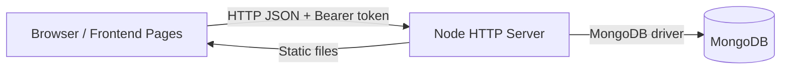

# Business Discovery — Project Guide for AI Coding Clients

## 1. Project Overview

Business Discovery is a web platform for managing business discovery projects, project members and participants, friends and partners, tasks, notifications, and chat conversations. It includes a site administration area for user statistics and application settings.

Current scope verified from source code:

- Multi-page frontend served by the Node backend.
- Custom HTTP server (not Express).
- MongoDB-backed persistence.
- Email/password authentication with signed tokens.

## 2. Technology Stack

Frontend:

- Static HTML pages (18 pages, using the Premium Futuristic 3D Creative SaaS design identity)
- Vanilla JavaScript (`frontend/assets/js/common.js`, `frontend/assets/js/layout.js`)
- CSS (`frontend/assets/css/main.css`) — centralized design system with CSS variables, glassmorphism, and reusable components
- Vendor libraries: GSAP, Lenis, Three.js, Lucide, SplitType

Backend:

- Node.js (built-in `http` module)
- Custom router (`backend/src/middleware/router.js`)
- MongoDB Node driver
- `helmet` and `cors` are listed in `backend/package.json` but are not required by the current application code

Database:

- MongoDB (Atlas in production; local MongoDB possible via configuration)

Authentication:

- Password hashing with `scrypt` (`backend/src/services/auth.js`)
- HMAC-SHA256 signed base64url tokens with `iat` and `exp`
- Bearer token in `Authorization` header
- Backend database role is the source of truth for authorization

Testing:

- Node built-in test runner (`node --test`)
- Tests in `backend/test/`

## 3. Repository Structure

```
business-discovery/
├── .env.example
├── README.md
├── package.json
├── backend/
│   ├── .env.example
│   ├── package.json
│   ├── scripts/
│   ├── src/
│   └── test/
├── database/
│   ├── collections.json
│   ├── indexes.json
│   ├── schemas/
│   └── seed/
└── frontend/
    ├── *.html
    └── assets/
```

Important files:

- `backend/src/server.js` — application entry point, DB connection, HTTP server startup.
- `backend/src/app.js` — request handling, CORS, static frontend serving.
- `backend/src/config.js` — environment validation and configuration.
- `backend/src/db/mongo.js` — MongoDB connection and collection map.
- `backend/src/middleware/auth.js` — authentication and role checks using DB role.
- `backend/src/services/auth.js` — password hashing, token signing/verification, role normalization.
- `frontend/assets/js/common.js` — frontend API helper and token storage.
- `frontend/assets/js/layout.js` — shared layout, navigation, role-based UI visibility.

## 4. Application Architecture

Frontend pages call the backend REST API using `fetch`. The backend validates the bearer token, looks up the current user in MongoDB, enforces authorization, performs data operations, and returns JSON. Static frontend files are served by the same Node process.

### Frontend Design System

All 18 frontend pages share a unified design system defined in `frontend/assets/css/main.css`:

- **Color tokens**: Deep Navy (#080B18), Secondary (#0D1224), Surface (#141B31), Electric Blue (#397BFF), Purple (#8B5CF6), Cyan (#35D5F2)
- **Glassmorphism**: `--glass` / `--glass-strong` with backdrop-filter blur and subtle glowing borders
- **Components**: `.btn`, `.input`, `.card`, `.table-wrap`, `.modal`, `.toast`, `.badge`, `.avatar`, `.empty-state`, `.spinner`, `.skeleton`
- **Layout**: `.app-shell`, `.sidebar`, `.topbar`, `.content` with fixed sidebar + mobile overlay
- **Responsive**: Mobile sidebar drawer (below 900px), stacked topbar (below 600px)
- **Reduced motion**: Respects `prefers-reduced-motion`

Design token classes:

- `.btn-primary`, `.btn-secondary`, `.btn-ghost`, `.btn-danger`
- `.badge-blue`, `.badge-purple`, `.badge-cyan`, `.badge-success`, `.badge-danger`
- `.input`, `.label`
- `.card`, `.card-header`
- `.empty-state`, `.spinner`, `.skeleton-text`, `.skeleton-title`



Request lifecycle:

1. Browser sends request to `/api/...`.
2. `app.js` routes API requests to the router.
3. Route handler authenticates via `requireAuth`/`requireAdmin`.
4. Middleware verifies token signature and expiration.
5. Middleware loads the current user and role from MongoDB.
6. Route performs validation and data access.
7. JSON response returned.

## 5. Authentication and Authorization

Registration:

- `POST /api/auth/register`
- Creates a user with role `regular_user`.
- Accepts a unique 3–30 character username and optional profile/CV details.
- Signup may also create the user's first project through the authenticated projects API.
- Passwords are hashed with `scrypt`.
- Email must be unique.

Login:

- `POST /api/auth/login`
- Verifies password hash.
- Returns a signed token with `iat` and `exp`.

Token handling:

- Token lifetime defaults to 15 minutes.
- Configurable via `ACCESS_TOKEN_TTL_SECONDS`.
- Expired, malformed, or invalidly signed tokens are rejected.
- Backend role is loaded from MongoDB on each authenticated request.

Roles:

- `regular_user`
- `site_admin`
- `main_super_admin`

Authorization:

- Backend authorization is authoritative.
- Frontend role checks only control UI visibility.

Main Super Admin provisioning:

- Use `backend/scripts/promote-super-admin.js`.
- Requires `ADMIN_EMAIL` (or `MAIN_SUPER_ADMIN_EMAIL`) and `ADMIN_PROVISION_CONFIRM=yes`.
- Promotes an existing user only; never creates an account.
- Does not run automatically.
- Register the administrator email through the normal signup flow first; then set the two one-time environment values and run `npm run provision:super-admin --prefix backend`.
- Public registration always creates a `regular_user`, even if a caller submits a role field.

Logout:

- Client clears the stored token.
- Server returns success but does not revoke tokens.
- Tokens remain valid until expiration.

## 6. Database

Database name defaults to `business_discovery`.

Collections used by code:

- `users`
- `user_states`
- `friend_requests`
- `friendships`
- `partner_invites`
- `partnerships`
- `app_settings`
- `projects`
- `project_members`
- `participants`
- `tasks`
- `notifications`
- `conversations`
- `messages`
- `ai_conversations`
- `project_assessments`
- `products`
- `orders`

Important relationships:

- Projects store their owner email in `owner`; project access is granted through `project_members`.
- Project membership is stored in `project_members`.
- Participants belong to a project via `projectId`.
- Tasks reference owner and assignee by email.
- Notifications are scoped by `userEmail`.
- Conversations store `members` as emails.

Data preservation requirements:

- Do not reset, drop, or overwrite production data.
- Preserve existing IDs and relationships.
- Database changes must be additive and reviewed.

The schema and index definitions use the runtime collection names `partner_invites` and `app_settings`. Participant reads are restricted to projects the authenticated user belongs to; participant creation, updates, and deletion require an owner, project manager, or project assistant role. Archived projects are hidden from the project list. Public homepage metrics are aggregate database counts rather than fixed figures. Unread chat counters use hashed email keys to avoid MongoDB dotted-field conflicts.

## 7. API Reference

Base API prefix: `/api`

Health:

- `GET /api/health`

Auth:

- `POST /api/auth/register`
- `POST /api/auth/login`
- `POST /api/auth/password-recovery`
- `POST /api/auth/reset-password-with-code`
- `POST /api/auth/reset-password`
- `GET /api/auth/me`
- `POST /api/auth/logout`

Public:

- `GET /api/public/stats`

Projects:

- `GET /api/projects`
- `POST /api/projects`
- `GET /api/projects/:id`
- `PUT /api/projects/:id`
- `DELETE /api/projects/:id`
- `POST /api/projects/:id/members`
- `DELETE /api/projects/:id/members/:email`
- `PUT /api/projects/:id/members/:email/role`

Participants:

- `GET /api/participants`
- `POST /api/participants`
- `PUT /api/participants/:id`
- `DELETE /api/participants/:id`

Tasks:

- `GET /api/tasks`
- `POST /api/tasks`
- `PUT /api/tasks/:id`
- `DELETE /api/tasks/:id`

For project-linked tasks, an assignee's attempt to set `done` creates a `pending_approval` request and notifies project managers. A manager can approve by setting the status to `done` or return the task to `open`. The backend enforces this flow; client controls are not authorization.

Notifications:

- `GET /api/notifications`
- `POST /api/notifications/:id/read`
- `POST /api/notifications/read-all`

Friends:

- `GET /api/friends`
- `POST /api/friends/requests`
- `POST /api/friends/requests/:id/accept`
- `POST /api/friends/requests/:id/reject`
- `DELETE /api/friends/requests/:id`
- `DELETE /api/friends/:email`

Partners:

- `GET /api/partners`
- `POST /api/partners/invitations`
- `POST /api/partners/invitations/:id/accept`
- `POST /api/partners/invitations/:id/reject`

Chat:

- `GET /api/conversations`
- `POST /api/conversations`
- `GET /api/conversations/:id/messages`
- `POST /api/conversations/:id/messages`
- `GET /api/ai/status`
- `POST /api/ai/projects/:id/plan`
- `GET /api/ai/projects/:id/chat`
- `POST /api/ai/projects/:id/chat`

Profiles and assessments:

- `GET /api/profile`
- `PUT /api/profile`
- `POST /api/profile/share`
- `DELETE /api/profile/share`
- `GET /api/public/profiles/:shareToken`
- `GET /api/projects/:id/assessments`
- `POST /api/projects/:id/assessments`

Registration and the profile editor save the username, display name, professional headline, location, website, bio, skills, experience, and education to the user's private profile. Username is unique and appears on the public CV only when that profile is explicitly shared.

Products, imports, and orders:

- `GET /api/commerce/settings`
- `PUT /api/commerce/settings`
- `GET /api/products`
- `POST /api/products`
- `PUT /api/products/:id`
- `DELETE /api/products/:id`
- `POST /api/products/import-preview`
- `POST /api/products/import-commit`
- `GET /api/public/shops/:sellerId`
- `GET /api/orders`
- `POST /api/orders`
- `POST /api/orders/:id/transfer-reference`
- `PUT /api/orders/:id/verify`
- `GET /api/commerce/summary`
- `GET /api/admin/payment-settings`
- `PUT /api/admin/payment-settings`
- `GET /api/admin/commerce/summary`

The assessment bank is `frontend/assets/data/assessment-questions.json`: 100 questions, 20 per category, with answers from 1 to 5. All five category scores contribute equally to the normalized 0–100 result. Only project owners, managers, and assistants can save or view assessment history.

Ollama status checks the configured server and confirms the configured model is installed. Planning and project chat read only the selected project, its latest 100-question assessment, and recent tasks; chat history is isolated by project and user. The assistant returns analysis and reviewable suggestions; it never creates tasks or performs payment, deletion, role, or external-message actions. A project manager must explicitly accept a suggested task.

Admin:

- `GET /api/admin/stats`
- `GET /api/admin/users`
- `GET /api/settings`
- `PUT /api/settings`

## 8. Frontend

Main pages (18 functional HTML files; `404.html` is the not-found page):

- `index.html` — landing page
- `login.html`, `register.html` — authentication
- `projects.html`, `participants.html` — project creation, editing/archiving, and participant management
- `friends.html`, `partners.html` — invitations, incoming requests, and confirmed relationships
- `tasks.html` — task creation, status updates, and owner deletion
- `notifications.html` — notification filtering and read state
- `chat.html` — conversation and message workflows
- `settings.html` — user appearance preferences and role-aware shortcuts for profile, projects, assessments, AI chat, products, orders, payments, and admin tools
- `admin.html` — administration
- `change-password.html` — password change
- `profile.html` — private CV/profile editing and optional share links
- `register.html` — account details, CV/profile information, and optional first-project creation
- `assessment.html` — the 100-question project assessment
- `assistant.html` — project-scoped Ollama chat and recommendations
- `commerce.html` — products, import drafts, seller settings, orders, and payment administration
- `shop.html` — public seller storefront and manual-transfer checkout

Authentication state:

- Token stored in `localStorage` under `bd_token`.
- `common.js` provides `BD.api()` for authenticated requests.

API requests:

- `BD.api(path, options)` adds JSON headers and bearer token.

## 9. Development Setup

Prerequisites:

- Node.js
- MongoDB (local or Atlas connection string)

Installation:
```
npm install --prefix backend
```

Environment:

- Copy `backend/.env.example` to `backend/.env`.
- Configure values without committing secrets.
- `OLLAMA_BASE_URL`, `OLLAMA_MODEL`, and `OLLAMA_TIMEOUT_MS` configure the local Ollama model used for project suggestions and PDF/DOCX import extraction.
- Start the Ollama service and install the configured model (for example, `ollama serve` and `ollama pull llama3.2`) on the machine reachable from the backend. The assistant page reports server/model status.
- `SMTP_HOST`, `SMTP_PORT`, `SMTP_USER`, `SMTP_PASS`, and `SMTP_FROM` configure password-recovery email delivery.

Start backend:
```
cd backend
npm start
```

The backend serves the frontend statically at the configured port.

Run tests:
```
cd backend
npm test
```

Syntax checks:
```
node --check backend/src/server.js
```

## 10. Security and Data Safety Rules

- Never expose secrets or credentials.
- Never commit `.env` files.
- Never delete, reset, drop, or overwrite production database data.
- Database changes must be additive, reviewed, and backed up.
- Backend authorization is authoritative; frontend visibility is not security.
- Preserve existing password hashes and user accounts.

## 11. Known Limitations

- Token revocation is not implemented; logout is client-side only.
- Token stored in browser localStorage.
- No automated database integration tests.
- Chat is request/response based, not real-time.
- Project chat and analysis require a reachable Ollama server and installed model. The AI uses project fields and the latest assessment; no external web-research provider is configured, so users must provide sources for market claims.
- Admin user search uses regex input without escaping.
- Password recovery email delivery depends on configured SMTP; delivery has not been verified.
- Product imports are limited to 1 MiB and 50 rows. CSV/XLSX parsing is local; PDF/DOCX extraction sends extracted text to the configured Ollama endpoint. Imports remain unpublished drafts until reviewed.
- PDF/DOCX extraction has not been verified end to end against representative documents; review extracted prices and descriptions before committing any draft.
- InstaPay is a manual transfer workflow with seller/admin verification, not a payment-provider integration. Order commissions are estimates only; no automatic collection, split, or settlement occurs.
- A super-admin role is not created by registration or by setting an email in configuration. Provisioning only promotes an existing account through the protected script.
- Unknown frontend paths return a branded 404 page; check local HTML links and asset paths rather than relying on a homepage fallback.

## 12. AI Development Instructions

Every future AI client must:

- Read this guide before modifying the project.
- Inspect the current code before making assumptions.
- Make small, scoped changes.
- Preserve existing API contracts unless a change is explicitly approved.
- Prioritize data correctness and data safety over UI changes.
- Run relevant tests and report actual results.
- Never claim a test or database check passed unless it was actually performed.

## 13. Future Roadmap — Planned, Not Implemented

These are future ideas only and are not currently implemented:

- Verified payment-provider integration, merchant onboarding, and commission settlement.
- Broader AI chat with user-scoped data access, model selection, rate limits, and auditable actions.
- Super-admin auditing and session/token revocation.
- End-to-end tests against a disposable MongoDB instance.

## 14. Frontend Redesign (3D Creative)

Redesigned pages:

- `frontend/index.html` — premium homepage with a connected Three.js network visualization, Lenis smooth scroll, feature cards, live statistics, and CTA.
- `frontend/login.html` — glassmorphism auth card, password toggle, validation, loading state, forgot-password modal, registration link.
- `frontend/register.html` — premium registration, password strength meter, confirm password, validation, loading/success/error states.

Design system additions in `frontend/assets/css/main.css`:

- New color tokens (cyan/violet/blue), glass surfaces, radius, shadows, spacing helpers.
- Reusable `.rd-*` component classes for nav, hero, cards, buttons, inputs, auth, modal, spinner.
- Reduced-motion support and responsive breakpoints.

Dependencies:

- Uses vendored `three.module.js` and its `three.core.js` dependency (MIT license at `frontend/assets/vendor/THREE-LICENSE.txt`), `lenis.mjs`, and copied `gsap.js` (minified UMD) from the root dependencies.
- No new npm dependencies installed.

Animation architecture:

- Three.js renders a connected network visualization; rendering pauses while hidden and respects reduced-motion preferences.
- Lenis provides smooth scrolling; disabled under reduced motion.
- CSS handles blobs, hover, transitions.

Authentication UI changes:

- Preserved existing `BD.api` integration and token storage.
- Added client-side validation matching backend rules (email format, password >= 8).
- Added code-based password recovery and temporary-password change flow. SMTP delivery remains an external prerequisite and has not been verified.

Files modified:

- `frontend/index.html`, `frontend/login.html`, `frontend/register.html`
- `frontend/assets/css/main.css`
- `frontend/assets/vendor/gsap.js` (replaced incomplete ESM shim with stable minified build)
- `docs/PROJECT_GUIDE.md`, `docs/FRONTEND_REDESIGN_REPORT.md`
- Voice interaction.
- Future integration with Nexus AI.
- Future integration with the user's other projects and website.
